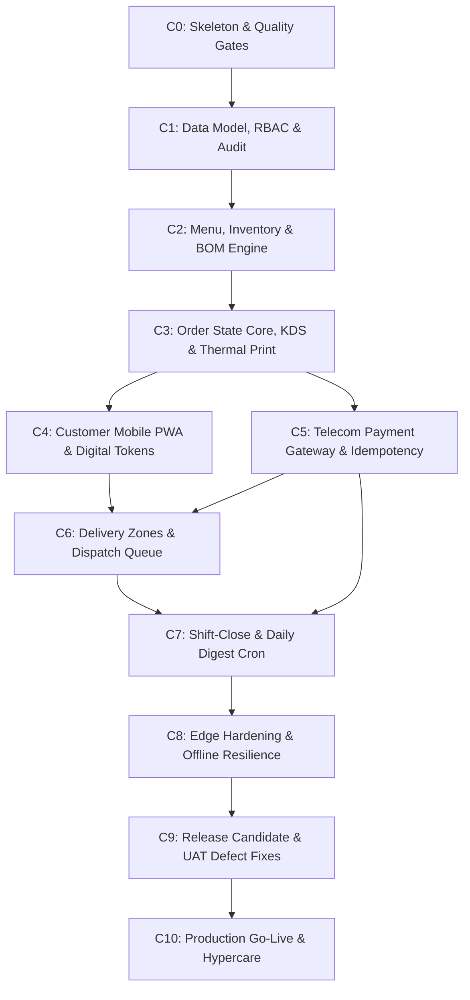

# Engineering Build Strategy & Technical Execution Phases (C0–C10)

**Document Type:** Core Engineering Architecture & Developer Build Blueprint  
**Target Environment:** Antigravity IDE + Opencode CLI Repository Scaffold  
**Framework:** TypeScript / Next.js 14 (App Router) + Fastify API Engine + Prisma ORM + PostgreSQL 16 + Redis 7  
**Target Hardware:** In-Store Intel NUC / Mini-PC Edge Node + 80mm ESC/POS Thermal LAN Printers  
**Target Locations:** Foodizo (Ham Towers) & Obunuzi Restaurant & Cafe (Opposite YMCA), Kampala, Uganda  
**Related Specifications:** `build_strategy/Dashboard_Build_Progression.md` · `docs/Tech_Stack.md` · `docs/Repo_Scaffold_and_Config.md` · `docs/Payment_Integration.md` · `docs/Delivery_Zones_and_Dispatch.md` · `docs/Hardware_and_Peripherals.md` · `docs/Seed_Data_and_Testing.md` · `docs/Deployment_Runbook.md` · `go_to_market/Go_To_Market_Strategy.md`

> **Implementation status:** This is the original planning blueprint, kept for delivery history. The shipped repository does **not** use Next.js, React, Redis, Docker Compose, or a separate worker. It is static HTML/CSS/JS served by `server.js`, a Fastify + Prisma + PostgreSQL backend, an in-process WebSocket bus, and an in-process `node-cron` digest scheduler. Route names and station splits below are the plan; the live surfaces are `/login`, `/pos`, `/kds`, `/dispatch`, `/admin`, and `/d/:token`. For the actual scaffold and dependencies, read `docs/Repo_Scaffold_and_Config.md`. For current test results, read `docs/Seed_Data_and_Testing.md`.

---

## 0. Screen-by-Screen Dashboard Build Chain

For the complete, step-by-step visual and interactive dashboard build progression (Customer PWA $\rightarrow$ Waitress Floor Dashboard $\rightarrow$ Kitchen KDS Displays $\rightarrow$ Dispatch Queue $\rightarrow$ Manager Executive Portal), see:
👉 **[`build_strategy/Dashboard_Build_Progression.md`](Dashboard_Build_Progression.md)**.

---

## 1. Executive Build Mandate: Build Strategy vs. Go-To-Market Strategy

> [!IMPORTANT]
> **Build Strategy is NOT Go-To-Market Strategy.**
> - **Build Strategy** is the technical engineering roadmap that dictates *how the software is designed, containerized, sequenced, coded, and verified by developers*. Its audience is software engineers, architects, and QA testers. Its gates are passing unit tests, database migrations, concurrency safety, offline LAN resilience, and typecheck passes.
> - **Go-To-Market (GTM) Strategy** is the commercial and operational adoption roadmap that dictates *how the system is launched in the market, how Makerere and YMCA students are converted to pre-orders, how waitstaff and kitchen staff adopt the tools, how commercial contracts are signed, and how food waste is economically reduced*. Its audience is restaurant owners (Zito Mbowe), outlet managers, and marketing leads.
> 
> Mixing them leads to premature marketing before software stability, or writing UI code without an underlying database foundation. This document governs **Technical Execution only**.

### 1.1 Core Engineering Principles

1. **Edge-First Offline Operation:** The in-store edge node (mini-PC running Docker Compose) is the primary source of truth. Dine-in ordering, kitchen ticket displays, table occupancy management, and ESC/POS chit printing MUST function seamlessly over local Wi-Fi/Ethernet even if the fiber or 4G connection is completely severed.
2. **Server-Owned State & Security:** The client is untrusted. Menu prices, delivery fees, order totals, and access permissions are resolved and enforced on the server. Client-supplied totals or fees are strictly ignored.
3. **No Paid Third-Party Map SDKs:** In Phase 1, there are zero billable Google Maps SDKs, Places APIs, or geocoding services. Delivery drop-offs use an outlet-scoped zone catalog, a mandatory 3–160 character landmark/room note, a rider-callable phone number, and a static universal Google Maps link (`https://www.google.com/maps/search/?api=1&query=...`).
4. **Strict KDS Privacy Boundary:** Kitchen display screens show ticket tokens, station items, preparation timers, and destination zone names. Customer phone numbers, room notes, GPS coordinates, and monetary prices are stripped before WebSocket broadcast and never reach the kitchen monitors.
5. **Concurrency-Safe & Append-Only Financials:** Every mobile money transaction is deduplicated using `UUIDv4` idempotency keys and an append-only `payment_events` ledger. Cash collections and rider transport advances are strictly balanced at shift close against physical drawer counts.

---

## 2. Technical Architecture & System Topology

```
                  ┌─────────────────────────────────────────────────────────┐
                  │                 EDGE SERVER (In-Store Local LAN)        │
                  │                                                         │
[ Customer PWA ] ─┼─► [ Next.js 14 App Router ] (:3000)                     │
[ Waiter POS   ] ─┤        │ (same-origin /api rewrite)                     │
[ Kitchen KDS  ] ─┤        ▼                                                │
[ Admin Portal ] ─┼─► [ Fastify API Engine ] (:4000)                        │
                  │        │                                                │
                  │   ┌────┴───────────────────────────┐                    │
                  │   ▼                                ▼                    │
                  │ [ PostgreSQL 16 Database ]   [ Redis 7 Event Bus ]      │
                  │   - Orders, Tokens, BOM        - WebSocket pub/sub      │
                  │   - Payments & Audit Log       - Real-time KDS sync     │
                  │   - Daily Digests              - In-memory rate limits  │
                  └────────┬───────────────────────────────────┬────────────┘
                           │ (Local TCP Socket :9100)          │ (External HTTPS)
                           ▼                                   ▼
              [ 80mm ESC/POS LAN Printer ]         [ External Cloud Services ]
              (Xprinter XP-80C Kitchen Expo)       - MTN MoMo Open API
                                                   - Airtel Money OpenAPI
                                                   - Africa's Talking SMS API
                                                   - Cloudflare Tunnel (Admin)
```

---

## 3. Engineering Build Phases: The C0–C10 Execution Order

The engineering pipeline is organized into **11 runnable, testable vertical slices**. Each phase has strict input dependencies, clear deliverables, and an exit quality gate. Development strictly follows this dependency sequence:

### 3.0 Phase Time Estimates

> [!NOTE]
> These are **engineering estimates for one experienced full-stack developer** working with the AI coding assistant. Estimates assume the spec is ready and no major rework is needed. Add 30–50% buffer for first-time setup, hardware procurement delays, or client feedback cycles.

| Phase | Estimated Developer Hours | Calendar Days (solo) | Delivery Stage |
| :--- | :---: | :---: | :--- |
| **C0** — Repository & quality gates | 4–6 h | Day 1 | Stage 1 |
| **C1** — Data model, RBAC & audit | 6–8 h | Day 2 | Stage 1 |
| **C2** — Menu, inventory & BOM engine | 8–12 h | Days 3–4 | Stage 2 |
| **C3** — Order core, KDS & thermal print | 12–16 h | Days 4–6 | Stage 2 |
| **C4** — Customer PWA & digital tokens | 10–14 h | Days 6–8 | Stage 2 |
| **C5** — Telecom payment gateway | 10–14 h | Days 8–10 | Stage 3 |
| **C6** — Delivery zones & dispatch | 10–12 h | Days 9–11 | Stage 3 |
| **C7** — Shift-close & daily digest | 6–8 h | Days 11–12 | Stage 3 |
| **C8** — Edge hardening & offline resilience | 8–10 h | Days 13–14 | Stage 4 |
| **C9** — Release candidate & UAT fixes | 6–10 h | Days 15–17 | Stage 4 |
| **C10** — Production hypercare | Ongoing | Days 18–30 | Stage 5 |
| **Total** | **~80–110 h** | **~17 working days** | — |

> **C5 and C6 can overlap** (run in parallel) once C3 and C4 are stable. C7 depends on both C5 and C6 being complete. Never start C8 while features are still being added.



---

### Phase C0: Repository Architecture & Quality Gates Skeleton

* **Objective:** Establish the clean monorepo skeleton, configure the Next.js 14 App Router, configure Fastify, wire Docker Compose, and establish mandatory automated quality gates.
* **Key Tasks:**
  1. Initialize directory structure: `src/app`, `src/components`, `src/lib`, `src/server`, `prisma`, `scripts`, `tests`.
  2. Configure root `package.json` with exact dependency locks (Next.js 14.2, Fastify 4.28, Prisma 5.19, Tailwind CSS, Lucide icons, Vitest).
  3. Set up `tsconfig.json` and `tsconfig.server.json` with strict typechecking enabled.
  4. Implement same-origin `/api` rewrite in `next.config.js` pointing to `http://localhost:4000` (or `http://api:4000` in Docker).
  5. Build Fastify server entrypoint (`src/server/index.ts`) with `@fastify/cors`, `@fastify/cookie`, `@fastify/rate-limit`.
  6. Implement `GET /health` endpoint reporting uptime, memory, and database connectivity.
  7. Author `Dockerfile.client`, `Dockerfile.server`, and `docker-compose.yml` with isolated network `foodizo_net`.
  8. Create `.env.example` (server secrets) and `.env.client.example` (public variables).
* **Exit Quality Gate:**
  - `npm run lint` passes with 0 warnings.
  - `npm run typecheck` passes with 0 errors.
  - `npm test` runs clean.
  - `docker compose build` succeeds with zero vulnerabilities.
  - `GET http://localhost:4000/health` returns `{"status":"ok"}`.

---

### Phase C1: Data Model, RBAC & Append-Only Audit Engine

* **Objective:** Implement the canonical relational database schema in PostgreSQL via Prisma ORM, enforce staff phone + PIN authentication, session management, and append-only auditing.
* **Key Tasks:**
  1. Deploy `prisma/schema.prisma` containing all 17 models (`users`, `user_sessions`, `audit_log`, `delivery_zones`, `restaurant_tables`, `menu_items`, `orders`, `order_items`, `raw_inventory`, `recipe_bom`, `closing_surplus_logs`, `delivery_handoffs`, `cash_counts`, `daily_digests`, `token_counters`, `payments`, `payment_events`) and 13 enums.
  2. Generate initial Prisma migration: `npx prisma migrate dev --name init_canonical_schema`.
  3. Implement PostgreSQL append-only trigger on `audit_log` preventing `UPDATE` or `DELETE` actions.
  4. Build password utility (`src/server/utils/password.ts`) with bcrypt cost 12 hashing for 4–6 digit staff PINs.
  5. Implement session service (`src/server/services/auth-service.ts`) using 32-byte cryptographically secure tokens stored as SHA-256 hashes in `user_sessions`.
  6. Configure Fastify auth plugin (`src/server/plugins/auth.ts`) validating `foodizo_session` cookie and enforcing 4-role RBAC: `CUSTOMER`, `WAITER_FOH`, `KITCHEN_STAFF`, `MANAGER_ADMIN`.
  7. Implement login brute-force protection: lock user accounts for 15 minutes after 5 consecutive failed attempts.
* **Exit Quality Gate:**
  - Database schema applies cleanly from zero.
  - Role matrix tests verify unauthorized access returns HTTP 403.
  - Audit log trigger blocks direct SQL updates with `'audit_log is append-only'`.
  - Session cookie uses `HttpOnly`, `SameSite=Lax`, and expires after 12 hours.

---

### Phase C2: Menu Catalogue, Raw Inventory & Recipe BOM Engine

* **Objective:** Build server-owned menu pricing, stock management, recipe Bill of Materials (BOM) deduction on preparation, and automated sold-out (auto-86) logic.
* **Key Tasks:**
  1. Build menu routes (`src/server/routes/menu.ts`) and service (`menu-service.ts`) serving active, non-86 items per outlet (`FOODIZO_HAM_TOWERS` vs `OBUNUZI_YMCA`).
  2. Implement raw inventory tracking with standardized units of measure (`uom_type`: `MILLILITERS`, `GRAMS`, `PIECES`, `PORTIONS`).
  3. Implement recipe BOM mapping table (`recipe_bom`) linking menu items to raw commodities (e.g., 2 eggs + 15ml oil per Rolex; 350g beef per Luwombo).
  4. Write atomic BOM deduction engine (`src/server/services/inventory-service.ts`) executing inside a database transaction when an order bumps to `PREPARING`.
  5. Implement auto-86 trigger: when an ingredient drops to 0, all dependent menu items automatically flag `is_86 = true`.
  6. Add low-stock threshold alerting when stock falls below `alert_threshold` (e.g., Cooking Oil < 5.0L).
  7. Implement closing surplus log endpoints (`POST /api/v1/inventory/surplus`) recording unsold batches with `DISCOUNTED_CLEARANCE`, `STAFF_MEAL`, or `WASTE_DISCARDED`.
* **Exit Quality Gate:**
  - Order preparation atomically deducts exact grams/milliliters.
  - Insufficient stock triggers `INSUFFICIENT_STOCK` rollback.
  - Reducing eggs to 0 immediately marks Rolex unavailable in the menu API.
  - End-of-day surplus logs record accurately without modifying historical sales.

---

### Phase C3: Order State Core, Real-Time KDS & Thermal Print Engine

* **Objective:** Implement the central order state machine, Redis pub/sub WebSocket synchronization, multi-station KDS views, and ESC/POS thermal printing over local TCP.
* **Key Tasks:**
  1. Build order management service (`src/server/services/order-service.ts`) enforcing the PRD-normalized lifecycle:
     - `AWAITING_PAYMENT` (holding gate; invisible to KDS)
     - `PENDING` (first kitchen-visible state)
     - `PREPARING` (on griddle/fryer; BOM decremented)
     - `READY` (plated/packaged; SMS and chit triggered)
     - `COMPLETED` (served or delivered)
     - `CANCELLED` (terminal exception with audit logging)
  2. Enforce postpay dine-in tab exception: authenticated FOH staff can create `DINE_IN` orders starting directly in `PENDING`. Public requests asking for `DINE_IN` are rejected with `POSTPAY_REQUIRES_STAFF`.
  3. Setup Redis pub/sub publisher and subscriber (`src/server/plugins/redis.ts`) broadcasting status updates over `ORDER_STATUS_CHANNEL` and `KDS_NEW_ORDER`.
  4. Wire `@fastify/websocket` delivering real-time ticket state to kitchen displays.
  5. Build multi-station KDS views in Next.js (`src/app/kds/*`):
     - Station 1: Luwombo / Steam Line (`/kds/steam`)
     - Station 2: Grill & Fryer (`/kds/fryer`)
     - Station 3: Rolex Griddle (`/kds/rolex`)
     - Station 4: Expo Pass / Packing (`/kds/expo`)
  6. Apply Design System tactile contracts: 68px full-width bump buttons, Plus Jakarta Sans display typography, JetBrains Mono data typography.
  7. Build raw ESC/POS thermal printing service (`src/server/services/printer-service.ts`) communicating over raw TCP socket to `192.168.1.200:9100`.
  8. Implement chit control-byte sanitization (`sanitizeChitText`) stripping ASCII control codes (`\x00-\x1F\x7F`) to prevent printer injection attacks.
  9. Enforce KDS privacy boundary: KDS tickets display destination zone name, token, and items, but NEVER customer phone numbers, room notes, GPS coordinates, or prices.
* **Exit Quality Gate:**
  - Bumping an order advances state atomically using `WHERE status = expectedStatus`.
  - Disconnecting WAN allows full KDS bump and LAN printing to continue uninterrupted.
  - Takeaway and delivery orders print an adhesive packaging chit on bump to `READY`. Dine-in does not print a bag chit.
  - KDS screens receive zero customer personal identifying information (PII).

---

### Phase C4: Customer Mobile PWA & Digital Token System

* **Objective:** Construct the high-speed, mobile-responsive progressive web app allowing students and office workers to browse menus, select fulfillment, and track pickup tokens.
* **Key Tasks:**
  1. Build customer pre-order interface in Next.js (`src/app/page.tsx`, `src/app/cart/page.tsx`, `src/app/checkout/page.tsx`).
  2. Apply Customer PWA visual personality: warm cream `#FAF8F5` surface, Chili `#C2410C` pill actions (`border-radius: 9999px`), soft warm shadows.
  3. Implement outlet selector: Foodizo Ham Towers vs. Obunuzi YMCA.
  4. Integrate client-side Cart store with local caching and stock-check validation.
  5. Implement daily digital token allocator in `order-service.ts` using PostgreSQL atomic upsert on `token_counters` (`INSERT ... ON CONFLICT DO UPDATE ... RETURNING last_value`). Tokens format as `TOKEN-001` to `TOKEN-999` scoped per outlet and Kampala business date.
  6. Build token view page (`src/app/token/[token]/page.tsx`) featuring 54px JetBrains Mono visual token card (`#042`), live status badge, and preparation countdown.
  7. Configure PWA web app manifest (`manifest.webmanifest`) and responsive mobile meta viewport.
* **Exit Quality Gate:**
  - PWA loads in < 1.5 seconds on simulated 3G mobile network.
  - Concurrent checkouts never allocate duplicate tokens for the same outlet date.
  - Customer order remains in `AWAITING_PAYMENT` state with clear instructions that prep begins only after payment confirmation.

---

### Phase C5: Telecom Payment Gateway & Webhook Idempotency Engine

* **Objective:** Integrate MTN Mobile Money and Airtel Money OpenAPI engines, process USSD STK pushes, handle webhooks idempotently, and provide manual verification fallbacks.
* **Key Tasks:**
  1. Build Ugandan MSISDN validator (`src/server/utils/msisdn-validator.ts`) standardizing numbers to E.164 (`256...`) and routing to MTN (`25677`, `25678`, `25676`) or Airtel (`25670`, `25675`, `25674`).
  2. Implement MTN MoMo Collections v1.0 client (`src/server/services/momo-service.ts`) dispatching `POST /collection/v1_0/requesttopay` with `UUIDv4` `X-Reference-Id`.
  3. Implement Airtel Money OpenAPI Merchant Pay v2.0 client (`src/server/services/airtel-service.ts`) with OAuth2 token caching.
  4. Build webhook receiver (`src/server/routes/payments.ts` `POST /api/v1/payments/webhook`) with provider IP validation and credential verification.
  5. Implement duplicate prevention: persist webhook events into `payment_events(provider, event_id)` with `UNIQUE` constraint; duplicate deliveries return HTTP 200 without side effects.
  6. Implement atomic database lock (`SELECT FOR UPDATE`) on `payments` and `orders`:
     - Successful payment promotes `orders.status` from `AWAITING_PAYMENT` $\rightarrow$ `PENDING`, firing ticket to KDS via Redis.
     - Second success for the same order moves to `REFUND_PENDING` with `audit_flag = 'DUPLICATE_SUCCESS_REQUIRES_REFUND'`.
     - Payment arriving on an already-cancelled order moves to `REFUND_PENDING` (`LATE_PAYMENT_AFTER_CANCEL`).
  7. Build cashier USSD fallback verification endpoint (`POST /api/v1/orders/:id/settle`): cashier enters full transaction ID (minimum 6 characters), amount, and phone. Creates `payments` row with `carrier = 'MANUAL_MOMO'`, `audit_flag = 'VERIFIED_MANUAL_MOMO'`, and `manual_verified_by`.
  8. Build manager refund closure endpoint (`POST /api/v1/payments/:id/refund`): manager enters external telco reversal reference, moving `REFUND_PENDING` $\rightarrow$ `REFUNDED` (terminal, excluded from gross).
* **Exit Quality Gate:**
  - Mock payment push succeeds and promotes order to `PENDING` within 45 seconds.
  - Replaying identical webhook payload returns `ALREADY_PROCESSED` without duplicating KDS tickets.
  - Cashier manual MoMo verification requires minimum 6-character transaction ID and records cashier UUID in audit log.

---

### Phase C6: Delivery Zones, Landmark Dropdowns & Dispatch Queue

* **Objective:** Build the local-first zone delivery system, server-side fee resolution, mandatory landmark note capture, and FOH dispatch queue.
* **Key Tasks:**
  1. Seed active delivery zones per outlet (`delivery_zones`: Lumumba Hall, Mitchell, Mary Stuart, YMCA Main Campus, Ham Towers, Wandegeya Market) with fixed fees (`UGX 1,000–3,000`) and ETAs.
  2. Build checkout delivery form enforcing required fields: active `delivery_zone_id`, `delivery_note` (3–160 chars), `customer_name`, and `customer_phone` (normalised E.164).
  3. Implement server-side delivery fee calculator: resolve `delivery_zones.fee_ugx` on the server and add to order subtotal; reject or ignore any client-supplied fee.
  4. Implement optional one-shot HTML5 GPS pin capture (`navigator.geolocation.getCurrentPosition`); denial or omission never blocks checkout.
  5. Generate static Google Maps universal link: `https://www.google.com/maps/search/?api=1&query=${lat},${lng}`. Zero paid map SDKs or API keys.
  6. Update ESC/POS Expo print template to include the delivery block: destination zone, room/office note, and rider-callable phone number.
  7. Build FOH Dispatch Queue screen (`src/app/pos/dispatch/page.tsx`):
     - Displays `READY` delivery orders.
     - Provides native `tel:+256...` and `wa.me/256...` deep links.
     - Provides **HAND TO RIDER** action: captures rider name, phone (optional), dispatch method (`CALL`, `WHATSAPP`), and cash transport advance (`rider_advance_ugx`).
  8. Implement delivery completion endpoint (`POST /api/v1/orders/:id/delivery-complete`): captures `DELIVERED` outcome, returned advance change, timestamp, and moves order to `COMPLETED`. Guard against direct KDS bumps to complete (`DELIVERY_COMPLETION_REQUIRES_HANDOFF`).
* **Exit Quality Gate:**
  - Submitting delivery checkout without room note or phone returns HTTP 422.
  - Client-tampered delivery fee is overridden by server zone price.
  - DevTools confirms 0 requests to Google Maps Platform APIs.
  - FOH dispatch records rider cash advance and reconciles returned change.

---

### Phase C7: Shift-Close Reconciliation & Daily Digest Cron Engine

* **Objective:** Implement physical cash count auditing, net rider advance calculations, and the automated 21:30 EAT owner audit digest.
* **Key Tasks:**
  1. Build cash count recording endpoint (`POST /api/v1/admin/cash-count`): manager submits physical drawer count per outlet. System computes `expected_cash = cash_sales - net_rider_advances` and generates `variance_ugx`.
  2. Build daily audit aggregation service (`src/server/services/daily-digest-service.ts`):
     - Gross collections grouped by carrier (`MTN`, `AIRTEL`, `MANUAL_MOMO`, `CASH`).
     - Delivery contribution memo: delivery fees collected minus net rider advances paid.
     - Cash reconciliation: counted cash vs expected cash.
     - Exception flags: `CASH_COUNT_MISSING`, `CASH_VARIANCE`, `REFUND_PENDING`, `LOW_STOCK`.
  3. Build Africa's Talking SMS renderer producing a maximum 2-segment text message. If cash count is unsubmitted, explicitly render `CASH COUNT MISSING - drawer not verified` (never a false zero).
  4. Build Nodemailer HTML/text email generator delivering comprehensive financial and inventory audit tables to Zito Mbowe.
  5. Implement `node-cron` scheduler (`src/server/jobs/daily-digest-cron.ts`) firing at `30 21 * * *` with explicit `timezone: 'Africa/Kampala'`.
  6. Implement Redis distributed lock (`lock:daily-digest:YYYY-MM-DD`, TTL 3600s) and database idempotency in `daily_digests` table (`digest_date` unique constraint).
  7. Add manual testing script: `npm run digest -- --date=YYYY-MM-DD --dry-run` rendering to console without dispatching live SMS/email.
* **Exit Quality Gate:**
  - Automated digest executes at 21:30 EAT in Kampala timezone.
  - Omitting the cash count outputs `CASH_COUNT_MISSING` and flags alert.
  - Re-running the cron job for the same date skips execution and avoids duplicate SMS charges.
  - Digest payload contains aggregate figures only; zero customer PII is transmitted.

---

### Phase C8: Edge Server Hardening, Offline LAN & Infrastructure

* **Objective:** Secure in-store edge container deployment, configure network isolation, prove offline LAN survival, and configure automated database backups.
* **Key Tasks:**
  1. Finalize production `docker-compose.yml`: bind Fastify API internally on `foodizo_net`, bind Next.js frontend to LAN IP port 3000, keep PostgreSQL (5432) and Redis (6379) unexposed to host/LAN.
  2. Configure router DHCP reservations for edge server (`192.168.1.100`), KDS tablets (`192.168.1.101–104`), and thermal printer (`192.168.1.200:9100`).
  3. Implement automated nightly backup script (`deploy/backup.sh`) executing `pg_dump` with gzip compression, writing to `/var/backups/foodizo/`, and enforcing 14-day rolling retention.
  4. Perform test restore drill into `foodizo_kds_restore` database verifying schema and data integrity.
  5. Conduct WAN-off test: pull the upstream WAN fiber/4G cable from the router; verify that table ordering, KDS ticket bumps, and Expo thermal printing remain 100% operational on LAN.
  6. Configure optional Cloudflare Tunnel (`deploy/cloudflared.yml`) providing secure remote admin access to `/admin/*` without opening router inbound ports.
* **Exit Quality Gate:**
  - WAN disconnection results in zero failed LAN order bumps or printing errors.
  - Database backup and test restore succeed without data loss.
  - Host port scan confirms only port 3000 (HTTP) and port 22 (SSH) are accessible on LAN.

---

### Phase C9: Release Candidate, Tablet Touch Testing & UAT Bug Fixes

* **Objective:** Deploy release candidate build to physical hardware, test touch ergonomics, run rush-hour stress simulations, and resolve defects.
* **Key Tasks:**
  1. Mount and test 4 KDS displays on kitchen wall brackets; verify 68px bump buttons can be easily pressed with wet/gloved hands.
  2. Implement browser Web Audio unlock banner ("Arm Sound") ensuring kitchen alert ticks sound on ticket arrival.
  3. Execute automated peak rush simulation (`scripts/simulate-rush-hour.ts`): generate 20 concurrent prepaid pre-orders and verify zero duplicate tokens and zero deadlocks.
  4. Test physical Expo printer paper cut and print density with 80mm adhesive thermal rolls.
  5. Verify role-based navigation guards: ensure KDS screens cannot access admin reconcile, and waiter accounts cannot approve voids without manager PIN.
  6. Triage and fix all Severity 1 (system blocking) and Severity 2 (major functional) defects.
* **Exit Quality Gate:**
  - `simulate-rush-hour.ts` passes with 20/20 unique tokens and 0 duplicate KDS tickets.
  - Zero open Severity 1 or Severity 2 bugs.
  - KDS audio alerts trigger reliably on incoming tickets.

---

### Phase C10: Production Deployment & Hypercare Engineering Support

* **Objective:** Deploy the verified release build to the physical restaurant edge server, conduct live verification, and provide 12-day hypercare engineering support.
* **Key Tasks:**
  1. Image edge mini-PC with Ubuntu 22.04 LTS, Docker, and Docker Compose.
  2. Run production database migrations and load verified production menu, BOM, tables, and delivery zones.
  3. Seed initial staff accounts with client-selected PINs (never commit real PINs to Git).
  4. Conduct dark service run: execute 5 live end-to-end orders across dine-in, takeaway, and delivery with real MTN and Airtel SIMs.
  5. Conduct first shift-close cash count and verify 21:30 EAT digest delivery to Zito Mbowe's phone and email.
  6. Provide on-site and remote hypercare technical monitoring (07:00–22:00 EAT) during the first 12 business days.
* **Exit Quality Gate:**
  - System operates in production for 5 consecutive business days with zero Sev 1 incidents.
  - All shift-close reconciliation reports balance with zero unexplained cash variance.
  - Stable handover package delivered to client lead.

---

## 4. Engineering Quality Assurance Matrix

| Check Type | Command | Enforcement Level | Blocking Criteria |
| :--- | :--- | :--- | :--- |
| **Linting** | `npm run lint` | Pre-commit / CI | Any error or warning fails the build |
| **Type Checking** | `npm run typecheck` | Pre-commit / CI | Any TypeScript compiler error fails the build |
| **Unit Testing** | `npm test` | Pre-commit / CI | Any failing Vitest spec fails the build |
| **Build Verification**| `npm run build` | Pre-deployment | Any Next.js or Fastify compilation error fails |
| **Concurrency Test** | `npm run test:rush` | Gate C5 & C9 | Any duplicate token or race condition fails |
| **Restore Drill** | `deploy/backup.sh && restore` | Gate C1 & C8 | Any backup corruption or schema mismatch fails |
| **LAN Offline Test** | Disconnect WAN router uplink | Gate C3 & C8 | Any failed local order, bump, or print fails |

---

## 5. Technical Risk Register & Engineering Mitigations

| Technical Risk | Impact | Engineering Mitigation Strategy |
| :--- | :--- | :--- |
| **Telco Webhook Retries / Duplicates** | High | Persistent `payment_events` deduplication table with `(provider, event_id)` unique constraint; database row locking (`SELECT FOR UPDATE`). |
| **Telecom USSD Downtime / Signal Loss** | High | Automated 45-second polling fallback; cashier manual USSD verification mode (`carrier = 'MANUAL_MOMO'`) requiring full 6+ char transaction ID. |
| **UMEME Load-Shedding / Power Cuts** | Critical | 1,000 VA pure sine wave UPS providing 25-minute runtime for edge server, switch, router, and printer; Docker services set to `restart: unless-stopped`. |
| **Local Wi-Fi / WAN Fiber Outage** | High | Edge server serves all local clients on in-store subnet (`192.168.1.0/24`); KDS bumps, table orders, and receipt printing operate completely offline. |
| **Printer Jam / Out of Paper** | Medium | Expo UI indicates printer status; FOH and Expo screens provide **REPRINT CHIT** button logging reprints to `audit_log`. |
| **Floating Point Currency Rounding** | Critical | PostgreSQL `NUMERIC(10,2)` and `Prisma.Decimal` used exclusively for all money math; zero JavaScript floating-point arithmetic for balances. |


---

## 6. Client Delivery Staging & Acceptance Gates (Stages 0–6 & RACI)

While Sections 1–4 dictate **how software engineers construct and verify the codebase** across coding phases C0–C10, this section defines **how the project is formally staged, evidenced, and signed off with client stakeholders (Zito Mbowe)**.

### 6.1 Delivery Stage Map

The windows below are proposed calendar days from contract kickoff, matching the 7 + 7 + 3 day commercial milestone baseline in `go_to_market/Service_Contract_and_Invoice_Template.md`:

| Stage | Window | Contract Link | Primary Output | Exit Gate |
| :--- | :--- | :--- | :--- | :--- |
| **0 — Mobilization & Readiness** | Days 1–2 | M1 Kickoff | Signed scope, data/hardware checklist, RACI, risk log | **G0** — Build authorized |
| **1 — Environment & Foundation** | Days 3–7 | Milestone 1 (C0–C1) | Edge node, Docker stack, PostgreSQL 16, Redis 7, RBAC & audit baseline | **G1** — Staging stable & reproducible |
| **2 — Core Operations** | Days 8–11 | Milestone 2 (C2–C4) | Menu/BOM, customer PWA, FOH POS, KDS stations, LAN thermal printing | **G2** — Order-to-KDS-to-chit verified on LAN |
| **3 — Payments, Delivery & Digest** | Days 10–14 | Milestone 2 (C5–C7) | MTN/Airtel STK & webhooks, landmark dispatch, cash counts, 21:30 digest | **G3** — Money & delivery reconcile |
| **4 — Hardening, UAT & Training** | Days 15–17 | Milestone 3 (C8–C9) | 39-point test pass, WAN-off drill, restore drill, staff role training | **G4** — Go-live formally accepted |
| **5 — Go-Live & Hypercare** | Days 18–30 | Milestone 4 transition (C10) | Live service support, daily standup, weekly reconciliation, stable handover | **G5** — Stable operations handover |
| **6 — Post-Pilot Review** | Day 30+ | Commercial review | Review volume, queue divert rate, Phase 2 evaluation | **G6** — Written decision on Phase 2 |

---

### 6.2 Acceptance Gate Criteria (G0–G6)

* **Gate G0 (Build Authorized):** Kickoff checklist signed; product scope & exclusions frozen; hardware & telco account owners assigned.
* **Gate G1 (Staging Stable):** Edge server environment reproducible from repo + `.env`; `/health` returns 200; RBAC tests pass; database backup & restore demonstrated on staging.
* **Gate G2 (LAN Flow Verified):** Dine-in tab completes full lifecycle; prepaid pickup order correctly held in `AWAITING_PAYMENT`; BOM decrement triggers on `PREPARING`; ESC/POS printer fires chit on `READY`; local order-to-print functions with router WAN uplink disconnected.
* **Gate G3 (Financial & Dispatch Reconciliation):** Sandbox MTN/Airtel payment succeeds; duplicate webhook creates zero duplicate tickets; delivery fee is strictly server-computed; rider advance balances at shift close; 21:30 digest runs idempotently without PII.
* **Gate G4 (UAT Accepted):** Zero open Sev 1 or Sev 2 defects; all 39 test checklist items in `Seed_Data_and_Testing.md` pass; restore drill verified; FOH and kitchen staff complete role training; client signs UAT acceptance sheet.
* **Gate G5 (Stable Handover):** 5 consecutive business days of live service with zero Sev 1 incidents; cash counts and daily digests reconcile without intervention; client lead assumes operational ownership.
* **Gate G6 (Phase 2 Review):** Volume & delivery performance reviewed against Phase 2 triggers (>100 deliveries/day, >5% address failures); written decision to maintain Phase 1 retainer or initiate Phase 2 discovery.

---

### 6.3 Project Workstreams & RACI Matrix

These are **project delivery responsibilities**, distinct from system access roles:

| Workstream | Contractor Lead | Client Lead (Zito Mbowe) | Outlet Staff | Notes |
| :--- | :---: | :---: | :---: | :--- |
| **Scope, Gates & Change Control** | **R/A** | **A** | C | Client accepts each milestone gate |
| **Edge Hardware & Environment** | **R/A** | C | I | Client provides power, UPS, and router access |
| **Menu, BOM & Pricing Data** | **R** | **A** | C | Client owns and verifies menu prices |
| **Telco Accounts & KYC** | C | **R/A** | I | Client-owned MTN and Airtel merchant accounts |
| **Core Application Engineering** | **R/A** | C | I | Contractor builds per C0–C10 roadmap |
| **UAT & Operational Testing** | C | **A** | **R** | Waitstaff and cooks test real workflows |
| **Staff Training** | **R/A** | C | **R** | Role-based tactile training on tablets |
| **Production Go-Live** | **R** | **A** | **R** | Joint go-live during low-risk service window |
| **Hypercare & Handover** | **R/A** | C | C | 12 business days of active monitoring |

*Key: R = Responsible for doing work, A = Accountable / Sign-off authority, C = Consulted, I = Informed.*
