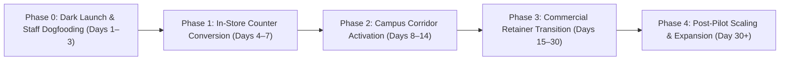

# Go-To-Market (GTM) Strategy & Commercial Adoption Playbook

**Document Type:** Commercial Market Entry, Customer Acquisition & Operational Adoption Blueprint  
**Target Eateries:** Foodizo (Ham Towers) & Obunuzi Restaurant & Cafe (Opposite YMCA)  
**Location:** Wandegeya Commercial & Student Corridor, Kampala, Uganda  
**Primary Commercial Stakeholder:** Zito Mbowe (Project Coordinator — MRFSS Project)  
**Target Customers:** Makerere University Students, YMCA Comprehensive Institute Students, Ham Towers Corporate Office Workers, Wandegeya Commuters & Hospital Visitors  
**Related Specifications:** `docs/Demo_Script_and_Closing_Strategy.md` · `docs/Service_Contract_and_Invoice_Template.md` · `docs/User_Profiles_Personas.md` · `docs/Delivery_Zones_and_Dispatch.md` · `docs/Daily_Audit_Digest.md` · `build_strategy/Build_Strategy_and_Phases.md`

---

## 1. Executive GTM Mandate: Go-To-Market vs. Build Strategy

> [!IMPORTANT]
> **Go-To-Market (GTM) Strategy is NOT Build Strategy.**
> - **Build Strategy** answers: *"How do software engineers write, containerize, test, and harden the database, KDS, payments, and printers?"* (See `build_strategy/Build_Strategy_and_Phases.md`).
> - **Go-To-Market Strategy** answers: *"How do we get Makerere and YMCA students to stop abandoning counter queues and pre-order on their phones? How do we train waiters and cooks to embrace digital tablets without slowing down service? How do we prove economic ROI to Zito Mbowe so he signs the commercial service contract?"*
>
> A technically flawless software system will fail commercially if cashiers do not encourage customers to scan QR codes, if cooks ignore screen alerts, or if students are unaware of the express pickup shelf. This document governs **Market Entry, Operational Adoption, and Revenue Growth**.

```
┌────────────────────────────────────────────────────────────────────────────────────────┐
│                                  THE CORE DISTINCTION                                  │
├───────────────────────────────────────────┬────────────────────────────────────────────┤
│         BUILD STRATEGY (Engineering)      │     GO-TO-MARKET STRATEGY (Commercial)     │
├───────────────────────────────────────────┼────────────────────────────────────────────┤
│ • Next.js 14, Fastify, Prisma, PostgreSQL │ • Makerere & YMCA Student Awareness        │
│ • Docker Compose & Local LAN Edge Node    │ • In-Store Express Shelf & QR Merchandising│
│ • C0–C10 Software Coding Phases           │ • Waitstaff & Kitchen Change Management    │
│ • Webhook Idempotency & Concurrency Locks │ • Cashier Counter-To-Mobile Scripting      │
│ • ESC/POS Raw Thermal Socket Printing     │ • Stage Boda Rider Transport Agreements    │
│ • Automated Unit, Integration & Load Tests│ • Milestone Invoicing & UGX 350k Retainer  │
│ • Quality Gates: Lint, Typecheck, Build   │ • KPIs: Queue Divert %, Spoilage Recovery  │
└───────────────────────────────────────────┴────────────────────────────────────────────┘
```

---

## 2. Market Landscape & Target Customer Segments

The Wandegeya corridor represents one of the densest, most fast-paced food-service environments in Kampala, characterized by sharp lecture break surges and high student price sensitivity.

```
                  ┌────────────────────────────────────────┐
                  │    WANDEGEYA FOOD SERVICE CORRIDOR     │
                  └───────────────────┬────────────────────┘
                                      │
            ┌─────────────────────────┼─────────────────────────┐
            ▼                         ▼                         ▼
  [ Makerere University ]   [ YMCA Comprehensive ]   [ Ham Towers & Wandegeya ]
  - 35,000+ Students        - 8,000+ Students        - Corporate Offices
  - 20-Minute Class Breaks  - High Commuter Density  - Retail Shop Owners
  - Severe Rush Hours       - Fast Casual Eating     - High Delivery Demand
  (Foodizo Target)          (Obunuzi Target)         (Foodizo & Obunuzi)
```

### 2.1 Segment Profiles & Value Propositions

| Customer Segment | Profile & Behavior | Primary Pain Point | GTM Value Proposition ("The Hook") |
| :--- | :--- | :--- | :--- |
| **Makerere University Students (Brian K.)** | Fast-walking, mobile-first students moving between Main Campus lecture halls and Ham Towers during 1:00–2:30 PM. | 15-person counter queues at Foodizo leading to missed lunches or late lecture arrivals. | *"Skip the 15-person counter line. Order from your lecture hall, approve MoMo, show your token at the Express Shelf, and leave in under 6 minutes."* |
| **YMCA Students & Commuters** | Price-conscious students seeking high-calorie, quick meals (Rolexes, chips, local sides) on tight daily allowances. | Slow order taking during peak lunch; sold-out items after queueing. | *"Instant live menu availability. Order hot food on your phone, pay exact mobile money, and pick up hot without delays."* |
| **Ham Towers & Wandegeya Office Tenants** | Corporate professionals, banking staff, and clinic workers taking lunch at desks. | Dislike leaving offices in the heat/rain; phone delivery orders frequently miscommunicated. | *"Direct desk delivery with landmark room notes. Know your food is on the way with verified pricing and rider dispatch."* |
| **Traditional Sit-Down Diners** | Lecturers, visitors, and evening diners eating Luwombo and Matooke at Obunuzi. | Waiters taking orders on greasy paper slips; forgotten side dishes or incorrect bills. | *"Prompt table-side digital ordering. What you order is what chef cooks, with immediate, transparent bill settlement."* |

---

## 3. Four-Phase Market Rollout Timeline

The commercial rollout is structured into **four sequential phases** designed to validate operational habits before driving mass customer traffic.



---

### Phase 0: Operational Readiness & Staff Dogfooding (Days 1–3)

* **Objective:** Verify operational workflows with zero public marketing. Staff eat their own meals through the system.
* **Target Outlets:** Foodizo (Ham Towers) & Obunuzi (Opposite YMCA).
* **Key Commercial Actions:**
  1. **Executive Kickoff:** Hold 45-minute orientation with Zito Mbowe, Mr. Cyrus (Foodizo Manager), and Mr. Mubiru Mahad (Obunuzi Lead). Confirm that pilot success metrics directly drive business profitability.
  2. **Staff Dogfooding Days:** For three consecutive lunch services, all staff lunches and shift meals MUST be ordered through the system:
     - Cashiers and waiters create test tickets on the handhelds.
     - Cooks fulfill tickets on the KDS screens.
     - Food is labeled via the Expo thermal printer.
  3. **Cashier Fallback Rehearsal:** Train counter cashiers to execute the manual USSD verification routine (`carrier = 'MANUAL_MOMO'`) and recognize genuine telecom SMS transaction codes vs. fraudulent screenshots.
  4. **Stage Boda Engagement:** Meet with the local stage chairman at the Wandegeya market boda stage. Agree on standard flat-rate transport advances (`UGX 1,500` for YMCA, `UGX 2,000` for Makerere halls).
* **Phase 0 Milestone Gate:** Staff complete 30 internal test orders across 3 shifts with zero unprinted tickets and 100% accurate shift-close drawer counts.

---

### Phase 1: In-Store Counter Conversion & Queue Bypass (Days 4–7)

* **Objective:** Divert walk-in queue customers at Ham Towers and table-side diners at Obunuzi to the digital workflow.
* **Key Commercial Actions:**
  1. **Physical Merchandising Installation:**
     - **Express Pickup Shelf:** Set up a clean, designated pick-up station at the front of Foodizo with a bold hanging sign: **"PRE-ORDER PICKUP — SHOW TOKEN HERE & SKIP THE LINE"**.
     - **Counter Standing Banners:** Place eye-level pull-up banner next to the register: *"Don't Wait in Line! Scan the QR Code on your phone, pay with MTN/Airtel, and grab your food at the Express Shelf."*
     - **Table QR Tents:** Place acrylic tent stands on all tables at Obunuzi (`T-01` to `T-04`, `B-01` to `B-02`) with direct links to browse the menu and view daily Luwombo specials.
  2. **Cashier Conversion Script:** When counter lines exceed 5 people, the secondary cashier steps out with a flyer or tablet:
     > *"Good afternoon! If you're rushing to class, scan this QR code right now on your phone. You can pay with MoMo, and your fried chicken will be ready at the shelf before you reach the front of this line."*
  3. **Launch Week Incentive:** "Free Passion Juice (300ml) with every 2pc Chicken & Chips ordered via the Pre-Order App during lunch hour."
* **Phase 1 Milestone Gate:** $\ge 25\%$ of peak lunch hour orders at Foodizo are processed via the customer pre-order app.

---

### Phase 2: Campus Corridor & Delivery Activation (Days 8–14)

* **Objective:** Expand awareness directly into Makerere University halls, YMCA classrooms, and Ham Towers commercial offices.
* **Key Commercial Actions:**
  1. **Campus Hall Ambassador Network:**
     - Recruit 4 student ambassadors across high-density Makerere residences (Lumumba Hall, Mitchell Hall, Africa Hall, Mary Stuart Hall).
     - Provide each ambassador with digital promotional graphics for WhatsApp student hall groups.
     - Message hook: *"Late for afternoon lecture? Foodizo Ham Towers now has express pre-orders. Order before leaving the hostel, food is hot when you arrive."*
  2. **YMCA Student Class Rep Outreach:**
     - Partner with YMCA student council and class reps to share the Obunuzi digital menu link in departmental WhatsApp groups.
  3. **Office Delivery Drop Campaign (Ham Towers & Wandegeya Market):**
     - Hand-deliver laminated desk flyers to 50 corporate offices in Ham Towers and surrounding commercial plazas.
     - Highlight the landmark drop-off feature: *"Order lunch to your desk. Select Ham Towers, specify your Floor & Office Number, and our runner delivers directly."*
  4. **7:30 PM Evening Luwombo Flash Clearance:**
     - Launch the manual evening clearance special: at 7:30 PM, manager reduces unsold Luwombo portions from `UGX 16,000` $\rightarrow$ `UGX 12,000` in the menu admin.
     - PWA highlights the item with an eye-catching **"Flash Clearance"** badge to capture evening commuter traffic.
* **Phase 2 Milestone Gate:** Delivery orders reach $\ge 30$ orders/day across Makerere and YMCA; evening Luwombo food waste drops by $\ge 40\%$.

---

### Phase 3: Commercial Retainer Transition & Audit Review (Days 15–30)

* **Objective:** Embed the operational daily habits, demonstrate financial ROI to Zito Mbowe, and execute the ongoing commercial maintenance agreement.
* **Key Commercial Actions:**
  1. **Weekly Executive Financial Reviews:** Sit down with Zito Mbowe every Monday at 9:00 AM to review the consolidated shift-close reconciliations and 21:30 audit digests:
     - Prove gross collections across MTN, Airtel, manual MoMo, and cash.
     - Highlight zero cash till shrinkage from rider transport advances.
     - Review surplus logs showing reduced food waste and improved batch planning.
  2. **Staff Excellence Recognition:** Award a small weekly bonus (`UGX 30,000`) to the floor waiter (Prossy) and cook (Chef Juma) with the fastest ticket turnaround times and lowest void counts.
  3. **Commercial Agreement Formalization:** Execute the formal transition from Milestone 3 (Training & Go-Live) to Milestone 4 (Ongoing Support Retainer — `UGX 350,000 / month`) under `docs/Service_Contract_and_Invoice_Template.md`.
* **Phase 3 Milestone Gate:** Zito Mbowe signs Milestone 3 acceptance and executes the first monthly retainer invoice payment.

---

### Phase 4: Post-Pilot Scaling & Long-Term Expansion (Day 30+)

* **Objective:** Evaluate pilot operational data, explore Phase 2 technical triggers, and assess multi-outlet expansion.
* **Key Commercial Actions:**
  1. **Pilot Evaluation Review (Stage 6 Gate):** Evaluate whether operational metrics meet the triggers defined in `docs/Delivery_Zones_and_Dispatch.md §11`:
     - Has delivery volume exceeded 100 orders/day outside the campus perimeter?
     - Are there 5+ full-time contracted riders requiring automated GPS dispatch?
     - If yes, present a separate technical proposal and budget for Phase 2 (Leaflet/OSM map integration and dedicated rider PWA).
     - If no, continue with the zero-map-fee landmark model that is already working profitably.
  2. **Multi-Store Licensing:** Present commercial terms to expand the software engine to additional food-service branches in Kikoni, Nakasero, or Kololo.

---

## 4. Staff Change Management & Behavioral Adoption Plan

Technology fails when front-line workers view it as surveillance or extra burden. The operational adoption plan ensures that floor staff and cooks feel empowered and supported.

```
┌────────────────────────────────────────────────────────────────────────────────────────┐
│                        BEHAVIORAL ADOPTION & CHANGE STRATEGY                           │
├───────────────────┬───────────────────────────────┬────────────────────────────────────┤
│ Staff Role        │ Initial Fear / Resistance     │ Operational Change Solution        │
├───────────────────┼───────────────────────────────┼────────────────────────────────────┤
│ **Waiters (FOH)** │ "Tablets will slow me down;   │ 6.5" tactile handheld terminal;    │
│ (Prossy N.)       │ paper chits are faster."      │ 2-tap order entry; live visual     │
│                   │                               │ table occupancy grid; zero walking │
│                   │                               │ back and forth to the kitchen.     │
├───────────────────┼───────────────────────────────┼────────────────────────────────────┤
│ **Kitchen Cooks** │ "My hands are wet and oily;   │ 15" industrial wall screen; giant  │
│ (Chef Juma)       │ screens will get ruined; I    │ 68px bump buttons; high-contrast   │
│                   │ prefer waiters shouting."     │ channel colors; audible audio ticks│
│                   │                               │ on incoming orders; zero shouting. │
├───────────────────┼───────────────────────────────┼────────────────────────────────────┤
│ **Cashiers**      │ "Customers will show fake     │ Strict manual verification rule:   │
│                   │ SMS messages; I will be held  │ cashier must enter full 6+ char    │
│                   │ responsible for till losses." │ transaction ID; system checks date │
│                   │                               │ and amount before releasing ticket.│
├───────────────────┼───────────────────────────────┼────────────────────────────────────┤
│ **Boda Riders**   │ "I don't want another app to  │ No app required! Rider receives an │
│ (Stage Runners)   │ install or drain my data."    │ adhesive thermal chit with clear   │
│                   │                               │ room note and phone number; cash   │
│                   │                               │ transport advance paid immediately.│
└───────────────────┴───────────────────────────────┴────────────────────────────────────┘
```

---

## 5. Marketing, Merchandising & Campaign Collateral

### 5.1 Physical Collateral Inventory

```
┌─────────────────────────────────┐   ┌─────────────────────────────────┐
│     COUNTER QR STAND (A5)       │   │     TABLE TENT CARD (A6)        │
│                                 │   │                                 │
│      DON'T STAND IN LINE!       │   │         OBUNUZI RESTAURANT      │
│                                 │   │                                 │
│  1. Scan to open menu:          │   │  Enjoying your meal?            │
│     [  QR CODE  ]               │   │  Next time, pre-order for pickup│
│                                 │   │  or desk delivery!              │
│  2. Pay via MTN / Airtel        │   │                                 │
│  3. Collect at Express Shelf!   │   │  [ QR CODE ]  Scan for Menu     │
│                                 │   │                                 │
│     foodizo.ug/menu             │   │  Free delivery to YMCA Campus   │
└─────────────────────────────────┘   └─────────────────────────────────┘
```

1. **Counter Acrylic QR Stands (A5):** Positioned directly at Foodizo counter registers.
2. **Express Shelf Hanging Sign (A3):** Bold high-visibility overhead signage directing pre-orderers past the queue.
3. **Table Tent Cards (A6):** Dual-sided laminated cards on all tables at Obunuzi.
4. **Corporate Desk Drop Cards:** Postcard-sized menus delivered to offices in Ham Towers.

### 5.2 Digital & Community Messaging Templates

**WhatsApp Broadcast for Student Groups:**
> *" Makerere Lunch Rush Hack! Don’t waste your 20-minute lecture break standing in the Foodizo line at Ham Towers. Pre-order 2pc Chicken & Chips or a Rolex on your phone right now  https://foodizo.ug. Pay with MoMo, walk straight to the Express Counter, grab your hot food, and head to class on time! "*

**Desk Delivery Message for Ham Towers Offices:**
> *" Hot Lunch Delivered to Your Office Desk! Obunuzi & Foodizo now deliver directly inside Ham Towers and YMCA. Order your Beef Luwombo or Chicken wrap online, add your Floor & Office Number, and our runner delivers to your door. No map pins needed. Order here  https://foodizo.ug"*

---

## 6. Commercial Model, Pricing & ROI Case for Zito Mbowe

To secure contract sign-off and retainer commitment from Zito Mbowe, the business case is framed strictly around **measurable cash recovery and leakage elimination**.

### 6.1 Commercial Pricing Structure

| Revenue Line | Amount (UGX) | Timing / Billing Mechanism |
| :--- | :--- | :--- |
| **Milestone 1: Kickoff & Environment** | `UGX 1,500,000` | Due upon contract signing & staging deployment |
| **Milestone 2: Configuration & Integration** | `UGX 1,500,000` | Due upon menu/BOM loading & sandbox payment test |
| **Milestone 3: Training & Go-Live** | `UGX 1,000,000` | Due upon successful live service day & UAT sign-off |
| **Total Implementation Fee** | **`UGX 4,000,000`** | **One-time commercial deployment** |
| **Ongoing Monthly Support Retainer** | **`UGX 350,000 / mo`** | **Billed monthly starting Day 31 (SLA & Backups)** |

### 6.2 The Economic ROI Proof for the Owner

Why Zito Mbowe cannot afford *not* to deploy this system:

1. **Recovering Peak Walk-Aways:**
   - Observation: Foodizo loses 20–30 potential customers daily between 1:00 PM and 2:30 PM due to counter congestion.
   - Financial Impact: Diverting just 20 extra orders per day at an average ticket of `UGX 12,000` = `UGX 240,000` additional gross revenue daily ($\approx \mathbf{UGX\ 6,240,000}$ per month).
2. **Luwombo Spoilage Reduction:**
   - Observation: Obunuzi discards or feeds to staff 4–6 unsold Luwombo portions daily due to lack of timely evening clearance.
   - Financial Impact: Recovering 4 portions daily via the 7:30 PM clearance special at `UGX 12,000` = `UGX 48,000` daily revenue ($\approx \mathbf{UGX\ 1,248,000}$ per month) that otherwise was written off as pure waste.
3. **Cash Drawer Shrinkage Elimination:**
   - Observation: Unrecorded boda transport advances (`UGX 2,000` per run) frequently lead to unexplained daily till shortages of `UGX 15,000–30,000`.
   - Financial Impact: Mandatory handoff advance logging eliminates `UGX 400,000–700,000` in monthly drawer discrepancies.
4. **Conclusion:**
   - Combined Monthly Bottom-Line Benefit: **$\approx \mathbf{UGX\ 8,000,000+}$ per month**.
   - Monthly Retainer Cost: **`UGX 350,000`**.
   - **ROI: Over 20x return on monthly software investment.**

---

## 7. GTM Key Performance Indicators (KPIs) & Target Scorecard

The success of the Go-To-Market rollout will be audited weekly against these concrete targets:

| GTM Metric | Measurement Method | 30-Day Pilot Target |
| :--- | :--- | :---: |
| **Peak Queue Divert Ratio** | Orders through customer PWA / Total orders during 1:00–2:30 PM | **$\ge 40\%$** |
| **Fast-Casual Turnaround Speed** | Time from payment webhook confirmation to bump to `READY` | **$< 7$ Minutes** |
| **Luwombo Plating Speed** | Time from KDS receipt to plating at Obunuzi steam pass | **$< 3$ Minutes** |
| **Food Spoilage Reduction** | Unsold portions recorded as `WASTE_DISCARDED` in surplus log | **$\ge 50\%$ Reduction** |
| **Delivery Dispatch Velocity** | Time from `READY` bump to rider departure on FOH queue | **$< 3$ Minutes** |
| **Cash Drawer Variance** | Absolute variance between counted cash and expected cash at close | **`UGX 0` Unexplained** |
| **Repeat Pre-Order Rate** | Percentage of students placing $\ge 2$ mobile pre-orders per week | **$\ge 35\%$** |
| **Retainer Conversion** | Signed ongoing monthly maintenance agreement with Zito Mbowe | **100% Executed** |

